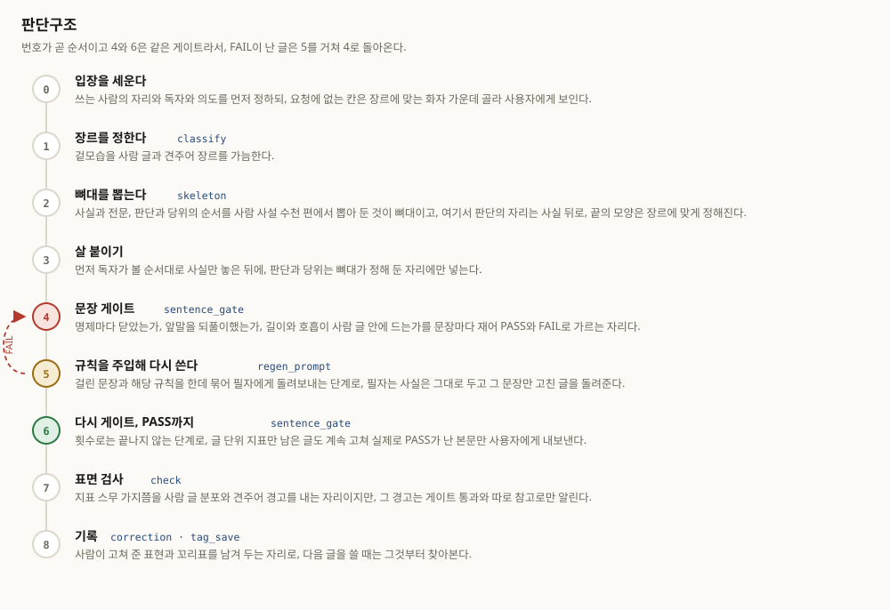

# dashi

<p align="center"></p>

**한국어 글에서 AI 티를 찾고 지우는 Claude Code 스킬 + MCP 서버.**

AI는 글을 AI 냄새가 나게 씁니다.
왜일까요?

ChatGPT의 등장 이후, 우린 처음에 놀랐습니다.

**"와 진짜 사람 같이 이야기하네"**

시간이 흐르며 우리의 기준이 높아지고 나니, AI가 쓴 글이 미묘하게
우리가 배워온 '한국어'와는 다르다는것을 느끼게 됩니다.

그 느낌의 이유는 AI가 애초에 한국인들의 전통적인? 학습과정을 거치지 않았기 때문이죠.
우리는 자연스럽게 유치원부터 고등학교까지 하다못해 중졸이어도, 
별헤는 밤. 봄. 같은 한국어로 된 소설과 그 문장의 아름다움.
혹은 친구와 함께하며 욕설과 농담을 주고 받으며, 
때론 신문, 뉴스에서의 정제된 화법. 예능에서의 재미있는 말투들을 보며 자연스레 한국어를 학습했습니다.

AI는 그런 과정을 거치지 않았습니다.
**생각보다 한국어는 어려운 언어입니다.
문법적으로도 그 구조가 영어와 완전히 다르고, 잘 쓴 글의 기준 조차도 영어와 완전히 다릅니다.**

심지어 사고방식 조차 서양인들과 우리는 완전히 다르죠,

예를 들어 우리는 대체로 "놀랍다" 라는 것을 명사화 하지 않습니다.
그냥 놀라우면 놀라운거지, "놀라움"을 느낀다. 라고 하지 않습니다.
감정은 내가 하는 행동이지, 피동으로 받아야 하는 그런 개념이 아닙니다.
흔한 명사화 번역투/피동 번역투 표현의 하나입니다.

하나 더 예시를 들면, 비유적인 표현입니다.
우린 대체로 빛이 "환/훤하다" "귀가 뜨인다" 라는 식으로 바라보는 주체가 빛나거나 변하는것으로 표현하지만,
영어에서는 "Crystal Clear", "a Bright idea" 라는 식으로 어떤 대상이 사물처럼 빛나는것을 관측한처럼 표현합니다.

그 외에도 강조를 할 때 우리는
"나는 세상 그 누구보다도 돈이 많다." 를 표현할때 강조를 위해 주로 '도치' 라는 방법을 사용합니다.
"난 돈이 많다, 세상 그 누구보다도." 하는 식으로 말입니다.
영어는 그 대신 중간에 끊는 식으로 호흡을 바꿉니다.
"I have more money than anyone in the world." → "I have more money than anyone. Anyone in the world."

-


예전 군 생활을 시작할 소위 시절, 보고서를 가지고 작전과장(소령)에게 가져가면 늘,
"다시" 라는 말을 듣곤 했습니다.

왜 이리 글이 중언부언 하냐, 줄이 왜 여기 있냐 하는 여러가지 이유로 말이죠.
그래서, 이 스킬도 그 떄의 그 신00 소령님의 대사인 **"다시"**를 떠올리며 만들었습니다.

하지만, 대AI시대에 인간이 매번 '다시' 시킬 순 없으니
알아서 "다시"를 해주게끔 만들었습니다. 이 스킬이 그 신00 소령님의 역할을 하는것이죠

**"다시"**


## 판단구조

<p align="center"></p>

<p align="center"></p>

그림은 기존 검사 흐름을 설명합니다. 현재 로컬 작성은 아래 통제 절차를 추가로 거칩니다.

**요청·원문 고정 → 근거 있는 계획 → 작성 또는 허용된 수정 → 실제 검사 → 실패 범위만 수정·재검사 → 별도 품질 검토 → 승인한 본문 그대로 전달**

품질 검토가 반려하면 **현재 본문의 지목된 부분만 수정 → 전체 실제 검사 → 새로운 독립 품질 검토**로 돌아갑니다. 요청·원문·계획·선택 자료는 그대로 유지하며, 장르 선택·계획·최초 작성을 다시 실행하지 않습니다. 검사 한도는 작업 전체에서 공유합니다.

작성 AI는 파일·쉘·MCP 도구를 쓰지 못하며, 스스로 PASS를 선언해도 검사 증거가 되지 않습니다. 관리 스크립트가 현재 작업과 검사 기록, 최종 본문의 해시를 대조해야 결과가 전달됩니다. 사람과 AI 유지보수자는 [설계 준수 계약](docs/ENFORCEMENT.md)을 반드시 따라야 합니다.

## 두 가지 사용 방식

| | 로컬 설치 | 공개 원격 서비스 |
|---|---|---|
| 지원 환경 | Linux x86_64, Python 3.12 | MCP HTTP를 지원하는 클라이언트 |
| 도구 수 | 16개 | 13개 |
| 논설·수필·공문 통제 작성/다듬기 | `compose` | 제공하지 않음 |
| 문학 방법 카드 | `lit_methods` | 제공하지 않음 |
| 수필 예문 조회 인터페이스 | `essay_example`; 예문 말뭉치 미포함 | 제공하지 않음 |
| 기존 장르 분류·문장·표면·법률·공문 검사 | 제공 | 제공 |
| 작성 모델 | 설치한 사용자의 Claude CLI, `claude-opus-5-5` 고정 | 작성 모델 연결 없음 |

이번 GitHub 배포는 로컬 통제 실행기의 컴파일 배포본입니다. 공개 Cloudflare 서비스는 기존 검사 서비스로 유지합니다. 원격 검사 연결만으로 통제 작성까지 설치되는 것은 아닙니다.

## 로컬 설치

Linux x86_64, Python 3.12와 `uv`가 필요합니다. 작성 기능은 사용자가 별도로 설치하고 로그인한 Claude CLI를 `PATH`에서 찾습니다. 실행할 때 `claude`가 검색되고 인증된 상태여야 하며, 모델 사용 권한과 사용량은 사용자 계정에 따릅니다. 검사 전용 도구는 작성 모델을 호출하지 않습니다.

```bash
git clone https://github.com/EESIZ/dashi ~/dashi
mkdir -p ~/.claude/skills
ln -s ~/dashi/skills/dashi ~/.claude/skills/dashi
sh ~/dashi/skills/dashi/install.sh
claude mcp add --scope user dashi -- ~/dashi/skills/dashi/.venv/bin/python ~/dashi/skills/dashi/scripts/dashi.py
```

이미 `dashi` 스킬이나 MCP 등록이 있으면 기존 경로를 확인하고 해당 등록을 갱신합니다. MCP 목록은 새 연결부터 반영됩니다. 다른 MCP 클라이언트에도 같은 Python 실행 파일과 `scripts/dashi.py`를 stdio 서버로 등록할 수 있습니다.

핵심 구현은 `skills/dashi/scripts/`와 `skills/dashi/guard/`의 컴파일 확장 모듈로 배포합니다. Python 원본을 내려받아 빌드하는 설치 방식이 아니며, 다른 운영체제·CPU·Python 버전의 바이너리는 제공하지 않습니다. 설치·업데이트·검증 기준은 [릴리스 문서](docs/RELEASE.md)를 참고하세요.

### 명령줄에서 작성·다듬기

UTF-8 JSON 파일 `task.json`에 실제 요청과 자료를 넣습니다. 아래 예시는 공문 날짜 표기만 고치는 작업입니다.

```json
{
  "request": "담당 직원에게 보낼 공문입니다. 원문의 내용은 보존하고 날짜 표기만 고쳐 주세요.",
  "source": "회의는 2026. 11. 05.에 개최합니다.  끝.",
  "selection": "admin_rules",
  "mode": "revise"
}
```

```bash
~/dashi/skills/dashi/.venv/bin/python ~/dashi/skills/dashi/scripts/compose.py --input task.json --output approved.txt
```

입력은 `request`, `source`, `selection`, `mode` 네 필드뿐입니다. `selection`은 사용자가 밝힌 `opinion`(논설), `essay`(수필), `admin_rules`(공문)를 사용하고, `mode`는 `draft`(새 작성) 또는 `revise`(다듬기)입니다. 필수 자료가 없거나 장르가 모호하면 보완을 요구합니다. 실패하면 후보 본문을 내보내지 않으며 기존 결과 파일도 유지합니다. 모델·도구·실행 파일은 입력으로 선택할 수 없습니다.

MCP에서는 같은 네 인자로 `compose`를 호출합니다. `DELIVERED`와 `delivered=true`인 결과의 `text`만 그대로 전달하며, 보고용 정보는 본문 밖에 둡니다. [스킬 사용 규칙](skills/dashi/SKILL.md)과 [실행 규약](skills/dashi/references/runtime.md)에 자세히 설명합니다.

## 원격 검사만 사용하기

공개 검사 서비스는 사용자 측 Python 설치 없이 연결할 수 있습니다.

```bash
claude mcp add --scope user --transport http dashi https://dashi.nisuwa.com/mcp
```

원격은 아래 공통 검사·참고 도구 13개만 제공합니다. `compose`가 없는 연결에서 AI가 직접 작성한 결과를 통제 실행기의 승인 결과로 취급하지 않습니다. 통제 작성이 필요하면 로컬 실행기를 설치합니다. 로컬과 원격을 함께 등록한다면 서로 다른 서버 이름을 사용합니다.

## 도구

| 도구 | 제공 위치 | 하는 일 |
|---|---|---|
| `compose` | 로컬 | 논설·수필·공문 작성/다듬기 전체 절차를 관리하고 승인 본문만 반환 |
| `lit_methods` | 로컬 | 문학 방법 카드 참고 |
| `essay_example` | 로컬 | 예문 조회 인터페이스; 원문 말뭉치는 배포하지 않아 `reference_not_distributed` 반환 |
| `route` | 로컬·원격 | 장르 경로와 필요한 정보를 판별; 로컬 작성은 `compose` 내부에서 실행 |
| `classify` | 로컬·원격 | 원문 장르 후보를 사람 글 분포와의 거리로 표시 |
| `opinion_guide` · `skeleton` | 로컬·원격 | 논설 절차·전개 방식과 문장 기능 뼈대 |
| `sentence_gate` · `regen_prompt` | 로컬·원격 | 문장 규칙 검사와 실패 문장의 교정 근거 |
| `check` · `tag_guide` | 로컬·원격 | 표면 지표와 판단 위치 참고 |
| `legal_guide` · `legal_examples` · `legal_style` | 로컬·원격 | 법률문서 전용 절차·판례 예문·문체 측정 |
| `admin_check` | 로컬·원격 | 공문·보도자료·조문의 표기·어문 검사 |
| `stats` | 로컬·원격 | 내장 분포의 장르별 편수 |

검사·참고 도구는 기준 분포를 바꾸지 않습니다. `compose`는 별도 모델을 실제 호출하며, CLI는 사용자가 지정한 결과 파일을 성공 시에만 교체합니다. 따라서 모든 도구를 단순한 읽기 전용 검사라고 표현하지 않습니다. MCP 작성은 수명 제한 임시 파일과 메모리를 사용하고 임시 파일을 종료 시 제거합니다. 사용자 파일, Claude CLI·모델 제공자·운영체제의 자체 보관까지 무저장을 보장하지는 않습니다.

내장 기준 분포는 다음과 같습니다.

| 장르 | 사람 글 | 시기 |
|---|---|---|
| 논설 | 사설 6,763편 | 2020~2022 |
| 법률문서 | 판결문·결정문 1,659편 | ~2021 |
| 행정문서 | 법령·행정규칙 6,971편(조문·서식·시행문), 보도자료 427편 | ~2021 |

수필 작성은 방법 카드와 전용 문장 검사로 지원합니다. `essay_example`의 수집 원문 말뭉치는 공개·비공개 Git 저장소와 컴파일 배포본에 포함하지 않습니다. 별도 원문을 준비하지 않은 배포본에서는 `reference_not_distributed`를 반환하며, 통제 작성은 이 예문 원문을 사용하지 않습니다. 위 세 장르와 같은 문학 전체의 기준 분포가 있다는 뜻은 아닙니다. 시·소설·희곡 전체의 작성 경로를 제공하지 않으며, 문장 기능 뼈대(`skeleton`)는 논설에만 있습니다. 법률문서는 기존 전용 절차를 따르고 `compose`의 자동 공개 대상에서는 제외합니다.

## 검증 결과와 한계

개발 단계의 고정 합성 과제 4개를 두 방식으로 각 2회 실행한 16회 비교에서, 기존 지침 전체 전달 방식과 통제 실행기 모두 8/8을 완료했습니다. 총 토큰은 316,373에서 132,909로 **57.99% 감소**, 블라인드 자연스러움 평균은 각각 **3.875/5**였습니다. 실행시간은 **3.69% 증가**했습니다. 같은 호출 횟수에서 반복 문맥을 줄인 결과이며, 모든 문서에서의 절감률이나 품질 동등성을 보장하지 않습니다. 이 역사적 비교를 현재 컴파일 릴리스의 새 성능 측정으로 바꾸어 주장하지 않습니다.

현재 릴리스의 검증 범위와 자료 위치는 [릴리스 문서](docs/RELEASE.md)에 기록합니다. 통제는 전용 실행기 안에서 성립하며, 일반 채팅 전체나 관리자 계정·운영체제까지 격리하는 장치는 아닙니다. 의미상 오류를 완전히 증명하지 못하고, 숫자 보호 규칙이 정상적인 삭제 요청도 보수적으로 차단할 수 있습니다. 그 경우에는 미완료로 알립니다.

## 라이선스

CC BY-NC 4.0. 비영리 사용·수정·재배포는 저작자(EESIZ) 표시 조건으로 허용하며, 상업적 이용은 허용하지 않습니다.
문의: esiz@nisuwa.com

참고 자료와 제3자 콘텐츠의 권리 범위는 [NOTICE.md](NOTICE.md)를 따릅니다.

## 제3자 소프트웨어 고지

아래 소프트웨어는 자체 라이선스를 따르며 `skills/dashi/requirements.txt`로 별도 설치합니다.

- [Kiwi / kiwipiepy](https://github.com/bab2min/Kiwi) 0.22.2 — 한국어 형태소 분석기 — GNU LGPL v3 ([본문](https://www.gnu.org/licenses/lgpl-3.0.html))
- [kiwipiepy_model](https://github.com/bab2min/Kiwi) 0.22.1 — Kiwi 모델 — GNU LGPL v3
- [mcp](https://github.com/modelcontextprotocol/python-sdk) 2.3.0 — Model Context Protocol Python SDK — MIT
- [pypdf](https://github.com/py-pdf/pypdf) 6.21.4 — PDF 읽기 — BSD-3-Clause
- [NumPy](https://github.com/numpy/numpy) 2.5.4 — 수치 연산 — 배포 패키지 고지의 BSD-3-Clause·0BSD·MIT·Zlib·CC0-1.0
- [tqdm](https://github.com/tqdm/tqdm) 4.70.1 — 진행 표시 — MPL-2.0 AND MIT
