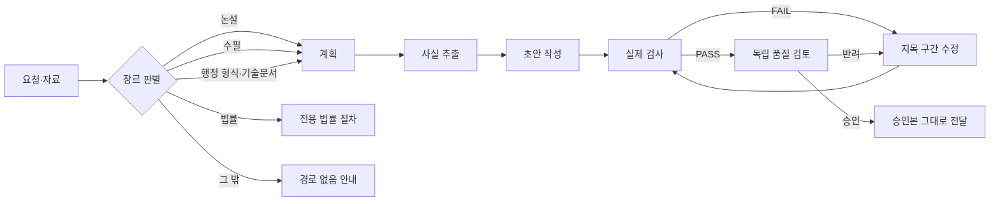
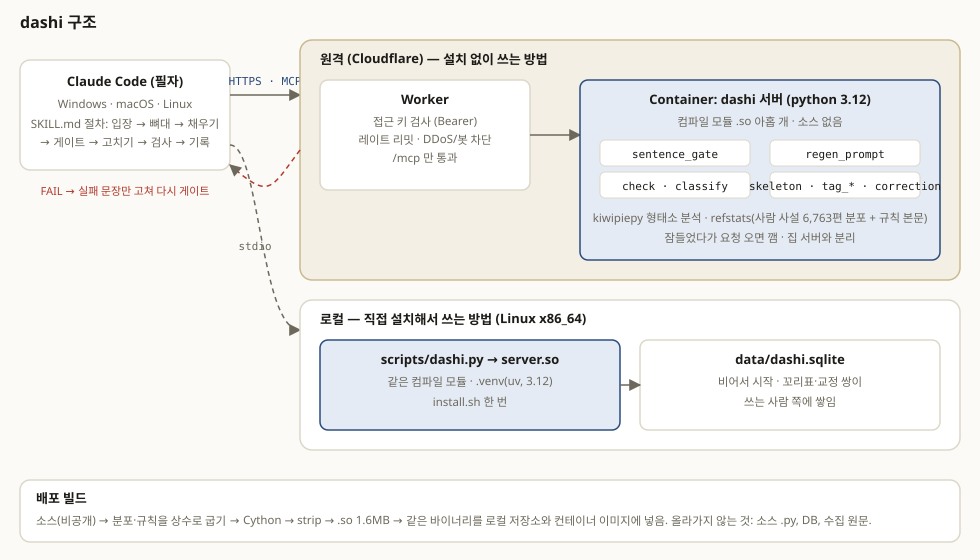

# dashi

<p align="center"></p>

**한국어 글에서 AI 티를 찾고 지우는 Claude Code 스킬 + MCP 서버.**

"다시."

소위로 군 생활을 시작했을 무렵, 저는 군수장교로 보직을 시작했습니다.

아무것도 모르는 25살이, 겨우겨우 작성한 보고서를 들고 작전과장 신00 소령님께 갈 때마는 늘 그 두 글자가 돌아오곤 했습니다. 


ChatGPT가 처음 나왔을 때 우리는 놀랐습니다. 와 이거 진짜 사람 같다고. 하지만,

시간이 지나면서 눈이 높아졌고. 이제는 AI가 쓴 한국어에서 우리가 배운 한국어와 조금 다른 결이라는것을 쉽게 알아챕니다.


저는 그 차이가 배운 방법이 달라서 생긴다고 생각합니다. 

우리는 유치원부터 고등학교까지 '별 헤는 밤'이나 '봄' 같은 글을 읽었고. 친구와는 욕설과 농담을 주고받았고, 

신문과 뉴스에서는 다듬어진 말을, 예능이나 개콘을 보고... 그런 자연스러운 언어습득 과정을 통해 한국어를 저절로 습득했습니다. 

그러나 AI는 그 길을 걷지 않았습니다.


"한글"과는 다르게 "한국어"는 생각보다 어려운 언어입니다. 

영어와는 문법 구조가 크게 다르고, 어떤 글을 잘 쓴 글로 치는지도 다릅니다. 

저는 심지어 한국 사람과 서양 사람은 어떤 현상을 떠올리는 연상, 사고 방식까지 다르다고 느낍니다.


한국인은 놀라우면 놀랍다고 합니다. 

일반적으로 '놀라움을 느낀다'고 쓰지는 않습니다. 가끔 그런 표현이 나오지만, 거의 번역문에서나 볼 수 있는 표현이기도 하고

애초에 한국인에게 감정은 어디서 건네받는 것이 아니라 내면에서 발현된 감정이기 때문입니다. 


비유하는 방식도 다릅니다. '우리는 눈앞이 환해지고, 귀가 뜨인다.' 이런식으로 어떤 깨달음을 통한 화자의 시야나 관점의 변화를 표현합니다.

영어에서는 'Crystal Clear'나 'a Bright idea'로 나와 분리된 어떤 대상이 사물처럼 빛나는 식으로, 화자가 대상의 변화를 관찰하듯 표현됩니다.


강조표현도 다릅니다. 한국어는 어떤 사실을 강조할때 주로 '도치' 혹은 수사의 중복, 생략, 높임/낮춤 등 다양한 방법을 이용해 강조합니다. 

예를들어 '내 월급이 적다.' 를 강조하기 위해서, '작은 내 월급' '내 월급은 너무너무 작다.' 식으로 표현하지만

영어는 'my 월급 is small'을 중간에서 끊어 'my 월급, small'로 호흡을 줄이며 바꾸거나, 접속사나 비유를 통해 강조하는것이 일반적입니다.


그 외에도, 한국어의 관용어구나 속담 같은 정형표현들은 한국어 화자간의 암묵적 약속으로 의미를 압축하기도 하고

한국어 교육과 관련해 그런 정형표현들이 한국어를 모어로 하는 화자의 어법을 배우는데 큰 도움이 된다는 연구도 있습니다.


하지만 AI는, 그런 모든 차이점을 전혀 인식하지 못합니다. 오히려 AI가 쓴 글이 인터넷에 늘어날 수록 점점 악화되고 있죠.

이런 한국어의 어색함을 바로잡으려면 누군가 몇 번이고 글을 검수하고 퇴고해야 합니다. 


그 시절 소령님이 그랬듯이 말이죠... 하지만 AI가 글을 쓰는 시대에 사람이 매번 다시 쓰라고 시킬 수는 없으니

이 스킬, dashi(다시)를 만들었습니다.

스킬 및 스크립트와 MCP 서버로 이루어진 이 도구는 한국어 글에 남은 AI 티를 찾아내고 지우고, 강제합니다. 


"다시."


## 판단구조

dashi 로컬 실행기는 새 글을 쓰는 작업만 수행합니다. 사용자가 글을 건네도 실행기는 그 글을 다듬지 않습니다. 실행기는 그 글을 사실을 뽑아내는 자료로만 사용합니다.

### 처리 순서

1. 실행기는 먼저 요청과 자료를 받습니다. 이어서 요청의 장르를 판별합니다. 장르가 애매하면 실행기는 사용자에게 다시 묻습니다. 판별을 마치면 실행기는 장르별 계획을 세웁니다.
2. 자료가 있으면 실행기는 자료에서 사실 관계만 추출합니다. 작성 모델은 사실 목록과 계획만 보고 초안을 씁니다. 작성 모델은 자료 원문을 보지 않습니다.
3. 초안이 나오면 장르별 실제 검사를 수행합니다. 검사가 문제 구간을 지목하면 그 구간만 수정합니다. 수정한 뒤에는 다시 검사합니다.
4. 검사를 통과하면 작성과 분리된 독립 품질 검토를 수행합니다. 독립 품질 검토는 본문을 자료 원문과 대조합니다. 검토가 반려하면 지목된 부분만 수정합니다. 수정한 본문은 전체 검사를 다시 거친 뒤 새 검토를 받습니다. 검토가 승인한 본문은 바뀌지 않은 채 그대로 전달됩니다.

### 횟수 제한

실제 검사는 작업 하나당 최대 4회까지 수행됩니다. 수정안 재시도는 작업 하나당 최대 2회까지 허용됩니다. 한도를 넘으면 실행기는 본문을 내보내지 않고, 작업을 미완료로 알립니다.

### 작성 모델의 권한과 전달 조건

작성 모델은 다음 도구를 쓸 수 없습니다.

- 파일 도구
- 쉘 도구
- MCP 도구

작성 모델이 스스로 `PASS`라고 밝혀도 그 말은 검사 증거로 인정되지 않습니다. 관리 스크립트는 다음 항목의 해시를 대조합니다.

- 현재 작업
- 검사 기록
- 최종 본문

관리 스크립트가 이 대조를 마쳐야 본문이 전달됩니다.

### 설계도 파일

행정 형식 문서와 기술문서는 서식마다 설계도 파일을 가집니다. 설계도 파일에는 다음 내용이 들어 있습니다.

- 작성 순서
- 검사 목록
- 검토 기준

실행기는 설계도 파일을 읽어서 작업을 실행합니다.

### 유지보수 규칙

사람 유지보수자와 AI 유지보수자는 모두 설계 준수 계약을 따릅니다. 설계 준수 계약은 `docs/ENFORCEMENT.md`에 있습니다.



장르마다 계획과 검사가 다릅니다.

**논설** · 사설·칼럼·연설문·논술·주장문


**수필** · 수필·기행문


**행정 형식·기술문서** · 공문·공고·공지·안내문·보고서·매뉴얼·업무 이메일·README


**법률** · 판결문·소장·의견서 · `compose` 밖 전용 절차


<p align="center"></p>


**문학** 

```개발중 - 사용은 가능하나, 품질을 보장할 수 없습니다.. 구조가 계속 변경되고 있어 확정된 후 표기하겠습니다.```


## 두 가지 사용 방식

| | 로컬 설치 | 공개 원격 서비스 |
|---|---|---|
| 지원 환경 | Linux x86_64, Python 3.12 | MCP HTTP를 지원하는 클라이언트 |
| 도구 수 | 16개 | 13개 |
| 논설·수필·행정 형식·기술문서 통제 작성 | `compose` | 제공하지 않음 |
| 문학 방법 카드 | `lit_methods` | 제공하지 않음 |
| 수필 예문 조회 인터페이스 | `essay_example`; 예문 말뭉치 미포함 | 제공하지 않음 |
| 기존 장르 분류·문장·표면·법률·공문 검사 | 제공 | 제공 |
| 작성 모델 | 설치한 사용자의 Claude CLI, `claude-opus-5-5` 고정 | 작성 모델 연결 없음 |

dashi는 두 가지 방식으로 사용할 수 있습니다. 하나는 로컬 통제 실행기이고, 다른 하나는 공개 원격 검사 서비스입니다. 이번 GitHub 배포본은 로컬 통제 실행기를 컴파일한 것입니다.

공개 원격 검사 서비스에는 `https://dashi.nisuwa.com/mcp` 주소로 연결합니다. 이 서비스의 특징은 다음과 같습니다.

- 검사와 참고에 쓰는 도구 13개만 제공합니다.
- 작성 모델이 연결되어 있지 않습니다.
- 사용자 쪽에 Python을 설치하지 않아도 연결할 수 있습니다.

원격 검사 서비스만 연결하면 통제 작성 기능은 설치되지 않습니다. 통제 작성 기능이 필요하면 로컬 실행기를 설치해야 합니다. 검사와 참고 기능만 필요하면 원격 서비스를 사용하면 됩니다.

`compose`가 없는 연결에서 인공지능(AI)이 직접 작성한 글은 통제 실행기가 승인한 결과가 아닙니다.

로컬 실행기와 원격 서비스를 함께 등록할 수도 있습니다. 함께 등록할 때는 두 서버에 서로 다른 서버 이름을 붙여야 합니다.

## 로컬 설치

```bash
git clone https://github.com/EESIZ/dashi ~/dashi
mkdir -p ~/.claude/skills
ln -s ~/dashi/skills/dashi ~/.claude/skills/dashi
sh ~/dashi/skills/dashi/install.sh
claude mcp add --scope user dashi -- ~/dashi/skills/dashi/.venv/bin/python ~/dashi/skills/dashi/scripts/dashi.py
```

dashi를 실행하려면 다음 환경이 필요합니다. Windows는 아래 WSL 방법을 씁니다.

- Linux x86_64
- Python 3.12
- uv

### Windows

Windows에서는 WSL(Windows 안의 리눅스) 안에서 dashi를 실행하고, Windows의 Claude Code나 Claude Desktop이 `wsl.exe`를 거쳐 접속합니다.

1. WSL이 없으면 관리자 PowerShell에서 `wsl --install -d Ubuntu`를 실행하고 재부팅합니다.
2. WSL을 열고 uv를 설치합니다: `curl -LsSf https://astral.sh/uv/install.sh | sh`
3. 저장소를 Windows에 받은 뒤 PowerShell에서 실행합니다.

```powershell
git clone https://github.com/EESIZ/dashi $HOME\dashi
powershell -ExecutionPolicy Bypass -File $HOME\dashi\skills\dashi\install-windows.ps1
# Claude Desktop에도 등록하려면 -Desktop, 배포판을 고르려면 -Distro Ubuntu
```

스크립트는 스킬을 WSL의 `~/.local/share/dashi-skill`에 복사해 설치하고, Windows Claude Code에 MCP `dashi`를 등록합니다. `-Desktop`을 주면 Claude Desktop 설정에도 추가하며 기존 설정은 `.bak`으로 남깁니다. 작성 기능(compose)은 WSL 안의 Claude CLI를 쓰므로, WSL에서 Claude Code를 설치하고 한 번 로그인해야 합니다. 검사 도구는 로그인 없이 동작합니다. ARM Windows는 지원하지 않습니다.

dashi의 핵심 구현은 `skills/dashi/scripts/`와 `skills/dashi/guard/`에 들어 있는 컴파일된 확장 모듈로 배포됩니다. 설치할 때 Python 원본을 내려받아 빌드하지 않습니다. 다른 운영체제, 다른 CPU, 다른 Python 버전용 바이너리는 제공하지 않으므로 위 환경에서만 dashi를 쓸 수 있습니다.

작성 기능은 Claude CLI를 사용합니다. Claude CLI는 사용자가 직접 설치하고 로그인해 두어야 합니다. 작성 기능은 `PATH`에서 Claude CLI를 찾습니다. 따라서 작성 기능을 실행하는 시점에 `claude`가 `PATH`에서 검색되고 인증된 상태여야 합니다. 모델 사용 권한과 사용량은 사용자의 계정을 따릅니다.

검사 전용 도구는 작성 기능과 달리 작성 모델을 호출하지 않습니다.

dashi 스킬이나 MCP 등록이 이미 있으면 기존 경로를 확인한 뒤 그 등록을 갱신합니다. MCP 목록의 변경은 새로 연결할 때부터 반영됩니다.

다른 MCP 클라이언트에도 dashi를 stdio 서버로 등록할 수 있습니다. 등록할 때는 같은 Python 실행 파일과 `scripts/dashi.py`를 사용합니다.


### 명령줄에서 작성

dashi는 요청과 자료를 담은 JSON 파일을 읽어 본문을 작성합니다.

먼저 요청과 자료를 UTF-8로 인코딩한 JSON 파일 `task.json`에 담습니다. 그런 다음 `compose.py`를 실행하면서 `--input task.json`과 `--output approved.txt`를 인자로 넘깁니다.

입력 JSON은 다음 세 필드만 받습니다.

- `request`: 작성할 내용에 대한 요청입니다.
- `source`: dashi가 사실을 추출하는 데 쓰는 자료입니다. dashi는 이미 쓴 글을 고쳐 다듬지 않으므로, 다듬을 글을 `source`에 넣어도 퇴고 결과를 얻을 수 없습니다.
- `selection`: 사용자가 직접 밝힌 장르입니다.

`selection`에는 다음 값을 쓸 수 있습니다.

- `opinion`(논설)
- `essay`(수필)
- `admin_rules`(공문)
- 장르 이름 `공고·공지`, `안내문`, `보고서`, `매뉴얼`, `업무 이메일`, `기술문서`

필수 정보가 빠졌거나 장르가 분명하지 않으면 dashi는 결과를 내지 않고 보완을 요청합니다. 

실행에 실패하면 dashi는 후보 본문을 출력하지 않습니다. 기존 결과 파일도 바뀌지 않고 그대로 남습니다.

사용할 모델, 도구, 실행 파일은 입력으로 지정할 수 없습니다.

MCP 환경에서는 같은 세 인자(`request`, `source`, `selection`)로 `compose`를 호출합니다. 호출 결과가 `DELIVERED`이고 `delivered=true`일 때만 결과의 `text`를 수정하지 않고 그대로 전달합니다. 보고용 정보는 전달하는 본문에 넣지 않고 따로 둡니다.

자세한 규칙은 다음 문서에서 확인할 수 있습니다.

- 스킬 사용 규칙: `skills/dashi/SKILL.md`
- 실행 규약: `skills/dashi/references/runtime.md`

```json
{
  "request": "아래 자료로 직원 대상 공지를 작성해 주세요. 내부 게시판에 올립니다.",
  "source": "발신: 정보화팀. 내용: 업무망 PC 보안 업데이트 일괄 적용. 일시: 2026년 11월 13일 18시 이후 자동 진행, 약 30분. 직원 조치: 퇴근 전 작업 파일 저장, PC 전원은 켠 채 로그아웃.",
  "selection": "공고·공지"
}
```

```bash
~/dashi/skills/dashi/.venv/bin/python ~/dashi/skills/dashi/scripts/compose.py --input task.json --output approved.txt
```

## 원격 검사만 사용하기

```bash
claude mcp add --scope user --transport http dashi https://dashi.nisuwa.com/mcp
```

## 도구

| 도구 | 제공 위치 | 하는 일 |
|---|---|---|
| `compose` | 로컬 | 논설·수필·행정 형식 문서·기술문서 새 작성의 전체 절차를 관리하고 승인 본문만 반환 |
| `lit_methods` | 로컬 | 문학 방법 카드 참고 |
| `essay_example` | 로컬 | 예문 조회 인터페이스; 원문 말뭉치는 배포하지 않아 `reference_not_distributed` 반환 |
| `route` | 로컬·원격 | 장르 경로와 필요한 정보를 판별; 로컬 작성은 `compose` 내부에서 실행 |
| `classify` | 로컬·원격 | 원문 장르 후보를 사람 글 분포와의 거리로 표시 |
| `opinion_guide` · `skeleton` | 로컬·원격 | 논설 절차·전개 방식과 문장 기능 뼈대 |
| `sentence_gate` · `regen_prompt` | 로컬·원격 | 문장 규칙 검사와 실패 문장의 교정 근거 |
| `check` · `tag_guide` | 로컬·원격 | 표면 지표와 판단 위치 참고 |
| `legal_guide` · `legal_examples` · `legal_style` | 로컬·원격 | 법률문서 전용 절차·판례 예문·문체 측정 |
| `admin_check` | 로컬·원격 | 공문·보도자료·조문의 표기·어문 검사 |
| `stats` | 로컬·원격 | 내장 분포의 장르별 편수 |

dashi의 도구는 모두 같은 방식으로 동작하지 않습니다. 어떤 도구는 읽기만 하고, 어떤 도구는 모델을 호출하거나 파일을 바꿉니다. 아래 설명으로 각 도구의 동작을 확인한 뒤 사용하십시오.

검사 도구와 참고 도구는 기준 분포를 변경하지 않습니다.

`compose`는 별도의 작성 모델을 실제로 호출합니다. 명령줄에서 실행하면 `compose`는 작업이 성공한 경우에만 사용자가 지정한 결과 파일을 교체합니다.

따라서 dashi의 도구가 모두 읽기 전용 검사 도구인 것은 아닙니다.

MCP 작성은 수명이 제한된 임시 파일과 메모리를 사용합니다. 작업이 끝나면 MCP 작성은 임시 파일을 삭제합니다.

다음 데이터는 무저장 보장 범위에 포함되지 않습니다.

- 사용자 파일에 남는 내용
- Claude CLI가 별도로 보관하는 데이터
- 모델 제공자가 별도로 보관하는 데이터
- 운영체제가 별도로 보관하는 데이터

내장 기준 분포는 다음과 같습니다.

| 장르 | 사람 글 | 시기 |
|---|---|---|
| 논설 | 사설 6,763편 | 2020~2022 |
| 법률문서 | 판결문·결정문 1,659편 | ~2021 |
| 행정문서 | 법령·행정규칙 6,971편(조문·서식·시행문), 보도자료 427편 | ~2021 |

dashi는 글 종류마다 기준과 검사를 따로 두고, 그 기준과 검사로 작성을 지원합니다. 글 종류별로 적용하는 검사는 다음과 같습니다.

- 논설: 사람이 쓴 글의 분포와 비교하는 문장 검사와 표면 검사를 함께 씁니다. 문장 기능 뼈대(`skeleton`)는 논설에서만 제공합니다.
- 행정 형식 문서: 서식별 검사를 씁니다. 이 검사는 날짜·시각·붙임 등의 표기 규칙, 끝 표시, 개조식 항목 줄의 끝맺음을 확인합니다.
- 기술문서(README 등): 본문의 명령어·경로·URL이 자료에 글자 그대로 있는지 검사합니다. 자료에 없는 명령어·경로·URL이 본문에 들어가면 검사는 실패로 처리합니다.
- 수필: 방법 카드와 수필 전용 문장 검사로 작성을 지원합니다.

`essay_example`의 수집 원문 말뭉치는 공개 저장소, 비공개 저장소, 컴파일 배포본 어디에도 들어 있지 않습니다. 사용자가 원문을 따로 준비하지 않으면 `reference_not_distributed`가 반환됩니다. 통제 작성에서는 `essay_example`의 예문 원문을 쓰지 않습니다.

dashi는 문학 전체를 대상으로 한 기준 분포를 제공하지 않습니다. 소설은 전용 경로로 작성합니다. 줄거리·인물·장면·메모 등을 자유 양식으로 넣습니다. 설정집은 `skills/dashi/novel/bible.py`로 관리하는 JSON 폴더입니다(사용법: `python bible.py manual`). 설정은 작중 시간 구간을 가진 사실로 저장되어, 바뀐 설정은 기록이 남고 폐기한 설정은 지워지며 `check`로 모순을 찾습니다. `bible.py pack`으로 묶은 설정집을 `settings`에 넣으면 dashi는 목차만 먼저 보고 필요한 항목만 꺼내 씁니다. 결과로 돌아오는 `bible_ops`를 `bible.py apply`로 반영하면 설정집이 갱신됩니다. 시, 희곡, 일기, 감상문은 전용 경로가 생기기 전까지 수필 경로로 작성하며, 이때는 수필의 절차와 검사가 적용됩니다.

법률문서는 전용 절차를 따릅니다. 법률문서는 `compose`의 자동 전달 대상에서 빠집니다.

## 검증 결과와 한계

dashi는 지금까지 개발 단계 비교와 행정 형식 시험, 두 가지 방법으로 검증했습니다. 이 절에서는 각 검증의 결과와 그 결과가 보장하지 않는 범위, 알려진 한계를 설명합니다.

개발 단계 비교에서는 기존 지침 전체를 전달하는 방식과 통제 실행기를 쓰는 방식을 같은 조건에서 실행했습니다.

- 고정된 합성 과제 4개를 사용했습니다.
- 방식마다 과제 하나를 2회씩 실행해 모두 16회 실행했습니다.
- 두 방식 모두 8회 중 8회를 완료했습니다.

두 방식을 비교한 결과는 다음과 같습니다.

- 총 토큰: 316,373에서 132,909로 줄었으며, 감소율은 57.99%입니다.
- 블라인드 자연스러움 평균: 두 방식 모두 3.875/5입니다.
- 실행시간: 3.69% 늘었습니다.

토큰이 줄어든 것은 호출 횟수를 같게 두고 반복되는 문맥을 줄였기 때문입니다. 따라서 이 결과는 모든 문서에서 같은 절감률을 보장하지 않으며, 같은 품질도 보장하지 않습니다.

2026-11-07에는 행정 형식 시험을 했습니다. 다음 7가지 형식을 1건씩 실행했습니다.

- 공문
- 공고
- 공지
- 안내문
- 보고서
- 매뉴얼
- 업무 이메일

7건 중 6건을 전달했고, 7건에 146,457토큰을 사용했습니다. 공고 1건은 끝 표시 검사에 결함이 있어 완료하지 못했습니다. 이후 끝 표시 검사를 고쳤지만, 고친 뒤의 재시험은 아직 하지 않았습니다. 행정 형식 시험 결과에 대해 사람이 내린 품질 판정도 아직 없습니다.

dashi를 쓰기 전에 다음 한계를 확인해 주세요.

- dashi의 통제는 전용 실행기 안에서만 성립합니다. dashi는 일반 채팅 전체를 격리하지 않으며, 관리자 계정이나 운영체제도 격리하지 않습니다.
- 검증을 통과해도 의미 오류가 없다는 것이 완전히 증명되지는 않습니다.
- 숫자 보호 규칙은 정상적인 삭제 요청도 막을 수 있습니다. 이 규칙이 삭제 요청을 막으면 dashi는 작업을 미완료로 알립니다.


## 라이선스

CC BY-NC 4.0. 비영리 사용·수정·재배포는 저작자(EESIZ) 표시 조건으로 허용하며, 상업적 이용은 허용하지 않습니다.
문의: esiz@nisuwa.com

참고 자료와 제3자 콘텐츠의 권리 범위는 [NOTICE.md](NOTICE.md)를 따릅니다.

## 제3자 소프트웨어 고지

아래 소프트웨어는 자체 라이선스를 따르며 `skills/dashi/requirements.txt`로 별도 설치합니다.

- [Kiwi / kiwipiepy](https://github.com/bab2min/Kiwi) 0.22.2 — 한국어 형태소 분석기 — GNU LGPL v3 ([본문](https://www.gnu.org/licenses/lgpl-3.0.html))
- [kiwipiepy_model](https://github.com/bab2min/Kiwi) 0.22.1 — Kiwi 모델 — GNU LGPL v3
- [mcp](https://github.com/modelcontextprotocol/python-sdk) 2.3.0 — Model Context Protocol Python SDK — MIT
- [pypdf](https://github.com/py-pdf/pypdf) 6.21.4 — PDF 읽기 — BSD-3-Clause
- [NumPy](https://github.com/numpy/numpy) 2.5.4 — 수치 연산 — 배포 패키지 고지의 BSD-3-Clause·0BSD·MIT·Zlib·CC0-1.0
- [tqdm](https://github.com/tqdm/tqdm) 4.70.1 — 진행 표시 — MPL-2.0 AND MIT
